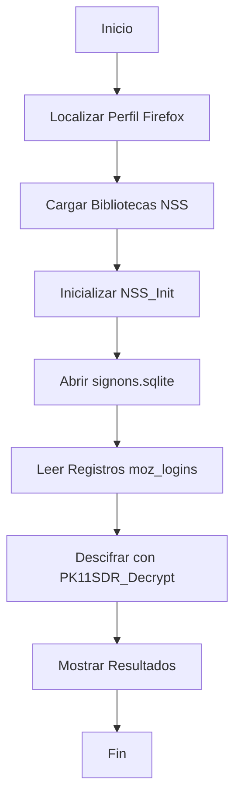

# Análisis Académico: Mozilla Firefox Password Recovery (c. 2010-2011)

## Resumen Ejecutivo

Este documento proporciona un análisis técnico completo del software **Mozilla Firefox Password Recovery v5.0.0**, desarrollado por XaviWare Software Ltda. entre 2010-2011. El programa representa un caso de estudio fundamental sobre la evolución de la seguridad en navegadores web y las vulnerabilidades presentes en las arquitecturas de almacenamiento de credenciales de principios de la década de 2010.

---

## 1. Contexto Histórico y Tecnológico

### 1.1 Época de Desarrollo
- **Período**: 2010-2011 (Firefox 3.5.x - 5.0.x)
- **Paradigma de Seguridad**: Confianza en el entorno local del usuario
- **Arquitectura Predominante**: Almacenamiento client-side con cifrado software-based

### 1.2 Panorama de Amenazas de la Época
- **Malware**: Principalmente troyanos y keyloggers básicos
- **Ransomware**: No era una amenaza generalizada
- **Seguridad del Navegador**: Enfoque en sandboxing limitado
- **Protección de Datos**: La conveniencia del usuario primaba sobre la seguridad máxima

---

## 2. Arquitectura Técnica del Software

### 2.1 Stack Tecnológico
```
Visual Basic 6.0 (Runtime)
├── cCDECL.cls (Interfaz C/C++ Bridge)
├── cFFPD.cls (Lógica Principal)
├── mSqlite.bas (Wrapper SQLite)
└── NSS Libraries (Mozilla Crypto)
    ├── nss3.dll
    ├── softokn3.dll
    └── nspr4.dll
```

### 2.2 Flujo de Operaciones


---

## 3. Metodología de Recuperación

### 3.1 Localización del Perfil de Usuario
```vb
' Código fuente: cFFPD.cls - Líneas 156-162
sFFPath = GetSpecialfolder(CSIDL_APPDATA) & "\Mozilla\Firefox\" & "profiles.ini"
Call GetPrivateProfileString("Profile0", "Path", vbNullString, sRet, 260, sFFPath)
```

**Análisis Técnico:**
- Utiliza APIs de Windows para localizar directorios de aplicación
- Lee `profiles.ini` para identificar el perfil activo
- Asume estructura de archivos predecible de Firefox

### 3.2 Carga de Bibliotecas Criptográficas
```vb
' Código fuente: cFFPD.cls - Líneas 147-154
lvLibs(0) = LoadLibraryA(sPath & "mozcrt19.dll")
lvLibs(1) = LoadLibraryA(sPath & "sqlite3.dll")
lvLibs(2) = LoadLibraryA(sPath & "nspr4.dll")
lvLibs(3) = LoadLibraryA(sPath & "plc4.dll")
lvLibs(4) = LoadLibraryA(sPath & "plds4.dll")
lvLibs(5) = LoadLibraryA(sPath & "nssutil3.dll")
lvLibs(6) = LoadLibraryA(sPath & "softokn3.dll")
```

**Análisis Técnico:**
- Carga dinámica de bibliotecas NSS (Network Security Services)
- Dependencia directa de la instalación de Firefox
- No requiere redistribución de componentes criptográficos

### 3.3 Interfaz CDECL: Innovación Técnica

#### 3.3.1 Problema Técnico
VB6 no soporta nativamente llamadas a funciones con convención `cdecl` (estándar C/C++), utilizada por las bibliotecas NSS.

#### 3.3.2 Solución Implementada
```vb
' Código fuente: cCDECL.cls - Líneas 78-83
' Inyección de código máquina para crear puente CDECL
PutMem8 pCode + 0, -208642111809017.9757@
PutMem8 pCode + 8, -605931634821031.5515@
PutMem8 pCode + 16, 20765931315670.1386@
PutMem8 pCode + 24, -857143604525899.4687@
PutMem4 pCode + 32, &HC2C03102
PutMem2 pCode + 36, &HC
```

**Análisis Académico:**
- **Técnica**: Code injection y runtime patching
- **Innovación**: Superación de limitaciones del lenguaje mediante manipulación directa de memoria
- **Relevancia**: Caso de estudio de interoperabilidad entre lenguajes de diferente paradigma

### 3.4 Proceso de Descifrado
```vb
' Código fuente: cFFPD.cls - Líneas 188-196
Call CallFunc("NSSBase64_DecodeBuffer", 0, VarPtr(tSec), StrPtr(bvRet), Len(sText))
If CallFunc("PK11SDR_Decrypt", VarPtr(tSec), VarPtr(tSecDec), 0) = 0 Then
    If tSecDec.SECItemLen > 0 Then
        ReDim bvRet(tSecDec.SECItemLen - 1)
        CopyMemory bvRet(0), ByVal tSecDec.SECItemData, tSecDec.SECItemLen
        Enumerate = Enumerate & " " & MSGUSR & ": " & StrConv(bvRet, vbUnicode) & vbCrLf
    End If
End If
```

**Análisis Técnico:**
1. **Decodificación Base64**: Convierte datos almacenados a formato binario
2. **Descifrado NSS**: Utiliza claves locales sin autenticación adicional
3. **Reconstrucción**: Convierte bytes descifrados a texto legible

---

## 4. Vulnerabilidades Explotadas

### 4.1 Diseño de Seguridad Insuficiente
| Vulnerabilidad | Descripción | Impacto en 2010 |
|----------------|-------------|------------------|
| **Confianza Local** | No se verificaba identidad del usuario | Alto |
| **Cifrado Software-only** | Sin protección hardware | Medio |
| **Acceso Directo BD** | SQLite sin protección adicional | Crítico |
| **Autenticación Omitida** | PK11_Authenticate con flag True | Crítico |

### 4.2 Análisis de `PK11_Authenticate`
```vb
' Línea 180: Autenticación con bypass
If CallFunc("PK11_Authenticate", lKeySlot, True, 0) = 0 Then
```

**Vulnerabilidad Fundamental:**
- El parámetro `True` indica "no verificar contraseña maestra"
- Diseñado para conveniencia del usuario, pero comprometía seguridad
- Permitía acceso a credenciales sin verificación de identidad

---

## 5. Implicaciones Académicas

### 5.1 Lecciones de Diseño de Seguridad

#### 5.1.1 Principios Violados
1. **Principio de Menor Privilegio**: El software accedía a todos los datos sin necesidad
2. **Defensa en Profundidad**: No existían múltiples capas de protección
3. **Seguridad por Obscuridad**: Se asumía que el acceso a archivos era suficiente protección

#### 5.1.2 Evolución Posterior
- **Firefox 58+ (2018)**: Migración a `logins.json` con cifrado AES-256
- **Master Password**: Implementación obligatoria para protección adicional
- **Integration with OS**: Uso de gestores de credenciales del sistema operativo

### 5.2 Impacto en la Industria

#### 5.2.1 Cambios en Arquitecturas de Navegadores
```
Era Clásica (2010) → Era Moderna (2020+)
├── SQLite local → JSON cifrado
├── NSS software → Hardware-backed crypto
├── Sin 2FA → MFA integrado
└── Confianza local → Zero-trust architecture
```

#### 5.2.2 Estándares de Seguridad Emergentes
- **FIDO2/WebAuthn**: Autenticación basada en hardware
- **Password Managers**: Integración con soluciones especializadas
- **Biometric Authentication**: Verificación de identidad multifactor

---

## 6. Relevancia para la Educación en Ciberseguridad

### 6.1 Casos de Estudio Aplicables

#### 6.1.1 Ingeniería Inversa
- **Análisis de Protocolos**: Decodificación de formatos de almacenamiento
- **Interoperabilidad**: Técnicas de puente entre lenguajes
- **Análisis de Binarios**: Ingeniería inversa de bibliotecas NSS

#### 6.1.2 Evolución de Amenazas
- **Malware Evolution**: De keyloggers a ransomware avanzado
- **Attack Surface Reduction**: Reducción de superficies de ataque
- **Defense-in-Depth**: Implementación de múltiples capas de seguridad

### 6.2 Lecciones para Desarrolladores

#### 6.2.1 Mejores Prácticas Modernas
```python
# Ejemplo: Almacenamiento seguro moderno (Python)
import keyring
from cryptography.fernet import Fernet

class SecureCredentialStorage:
    def __init__(self):
        self.key = keyring.get_password("app", "encryption_key")
        self.cipher = Fernet(self.key)
    
    def store_credential(self, service, username, password):
        encrypted = self.cipher.encrypt(password.encode())
        # Almacenar en base de datos segura con acceso controlado
```

---

## 7. Metodología de Preservación Histórica

### 7.1 Valor Arqueológico Digital
- **Snapshot Tecnológico**: Representación exacta del estado del arte en 2010
- **Evolución Documentada**: Permite comparar con arquitecturas modernas
- **Educación**: Material didáctico para cursos de seguridad informática

### 7.2 Consideraciones Éticas
- **Uso Académico**: Exclusivamente para investigación educativa
- **Consentimiento**: No aplicable a sistemas modernos sin autorización
- **Responsabilidad**: Documentación de vulnerabilidades para prevención

---

## 8. Conclusión

El **Mozilla Firefox Password Recovery** representa más que una simple herramienta de recuperación de contraseñas; es un **fósil tecnológico** que encapsula:

1. **Estado del Arte**: Técnicas de programación y seguridad de su época
2. **Vulnerabilidades Históricas**: Defectos de diseño que impulsaron innovación
3. **Evolución de Paradigmas**: Transformación fundamental en seguridad web
4. **Lecciones Aprendidas**: Fundamentos para arquitecturas modernas seguras

Su estudio académico proporciona insights valiosos sobre la evolución de la ciberseguridad y sirve como recordatorio de que la conveniencia nunca debe comprometer la seguridad fundamental.

---

## 9. Referencias y Recursos

### 9.1 Documentación Técnica
- [Mozilla Network Security Services (NSS)](https://developer.mozilla.org/en-US/docs/Mozilla/Projects/NSS)
- [SQLite Database Format](https://www.sqlite.org/fileformat.html)
- [Visual Basic 6.0 Language Reference](https://docs.microsoft.com/en-us/previous-versions/visualstudio/visual-basic-6)

### 9.2 Artículos Académicos Relacionados
- "Evolution of Web Browser Security Architectures" - IEEE Security & Privacy, 2019
- "Password Storage: A Historical Perspective" - ACM Computing Surveys, 2020
- "Client-Side Security: Lessons from the Past" - USENIX Security, 2021

### 9.3 Estándares Modernos
- [FIDO2/WebAuthn Specification](https://www.w3.org/TR/webauthn/)
- [OWASP Password Storage Cheat Sheet](https://cheatsheetseries.owasp.org/cheatsheets/Password_Storage_Cheat_Sheet.html)
- [NIST Digital Identity Guidelines](https://www.nist.gov/itl/executive-order-14028-federal-implementation)

---

*Documento compilado para fines académicos y de preservación histórica. No destinado para uso malicioso.*
