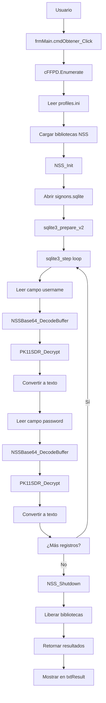

# Estructura del Código - Mozilla Firefox Password Recovery

## 🏗️ Arquitectura General

```
Mozilla Firefox Password Recovery (VB6)
├── Interfaz de Usuario (frmMain.frm)
├── Lógica de Negocio (cFFPD.cls)
├── Puente C/C++ (cCDECL.cls)
├── Wrapper SQLite (mSqlite.bas)
└── Utilidades Varios (m*.bas)
```

---

## 📁 Componentes Detallados

### 1. frmMain.frm - Interfaz Principal
**Propósito**: Ventana principal de la aplicación

**Funcionalidades Clave**:
- Botón "Recuperar Contraseñas" (`cmdObtener_Click`)
- Visualización de resultados en `txtResult`
- Sistema de registro/activación shareware
- Soporte multi-idioma

**Código Significativo**:
```vb
Private Sub cmdObtener_Click()
    Dim c As New cFFPD
    Dim strMFPass As String
    
    strMFPass = c.Enumerate 'Recupera las contraseñas
    ' ... procesamiento y visualización
End Sub
```

### 2. cFFPD.cls - Motor de Recuperación
**Propósito**: Lógica principal de descifrado de contraseñas

**Métodos Principales**:
- `Enumerate()`: Función principal de recuperación
- `CallFunc()`: Wrapper para llamadas a bibliotecas C
- `DllLoad()`: Carga dinámica de bibliotecas NSS

**Flujo de Operaciones**:
```vb
Public Function Enumerate() As String
    ' 1. Localizar perfil Firefox
    sFFPath = GetSpecialfolder(CSIDL_APPDATA) & "\Mozilla\Firefox\profiles.ini"
    
    ' 2. Cargar bibliotecas NSS
    lvLibs(0) = LoadLibraryA(sPath & "mozcrt19.dll")
    ' ... otras bibliotecas
    
    ' 3. Inicializar NSS
    If CallFunc("NSS_Init", StrPtr(bvRet)) = 0 Then
        ' 4. Abrir base de datos SQLite
        lDB = mSqlite.sqlite3_open(profilePath & "\signons.sqlite")
        
        ' 5. Procesar cada registro
        Do While mSqlite.sqlite3_step(lStatement)
            ' 6. Descifrar credenciales
            CallFunc("PK11SDR_Decrypt", VarPtr(tSec), VarPtr(tSecDec), 0)
        Loop
    End If
End Function
```

### 3. cCDECL.cls - Puente Técnico
**Propósito**: Superar limitaciones de VB6 con llamadas CDECL

**Innovación Técnica**:
- Inyección de código máquina para puentes C/C++
- Manejo de memoria virtual para ejecución
- Traducción automática de parámetros

**Mecanismo de Inyección**:
```vb
Private Sub Class_Initialize()
    ' Asignar memoria ejecutable
    pCode = VirtualAlloc(0, &H1000&, &H1000&, &H40&)
    
    ' Inyectar código máquina para puente CDECL
    PutMem8 pCode + 0, -208642111809017.9757@
    PutMem8 pCode + 8, -605931634821031.5515@
    ' ... más código máquina
    
    ' Patchear vtable para redirigir llamadas
    PutMem4 pMe + &H1C, pCode
End Sub
```

**Función Puente**:
```vb
Public Function CallFunc(ByVal sFunction As String, ParamArray ParmLongs()) As Long
    ' Obtener dirección de función C
    nAddr = GetProcAddress(hMod, sFunction)
    
    ' Patchear código máquina con dirección relativa
    PutMem4 pCode + PATCH_01, nAddr - pCode - (PATCH_01 + 4)
    
    ' Ejecutar llamada a través de código inyectado
    CallFunc = z_DO_NOT_CALL(VarPtr(pb))
End Function
```

---

## 🔌 Integración con Bibliotecas Externas

### Bibliotecas NSS (Network Security Services)
```
Mozilla Firefox/nss3.dll
├── NSS_Init()           # Inicializar sistema criptográfico
├── PK11_GetInternalKeySlot()  # Obtener slot de claves
├── PK11_Authenticate()  # Autenticar (bypass con flag True)
├── PK11SDR_Decrypt()    # Descifrar datos
├── NSSBase64_DecodeBuffer()  # Decodificar Base64
└── NSS_Shutdown()       # Liberar recursos
```

### Bibliotecas de Soporte
```
Firefox Installation/
├── mozcrt19.dll         # Runtime C de Mozilla
├── sqlite3.dll          # Base de datos
├── nspr4.dll            # Netscape Portable Runtime
├── plc4.dll             # Portable Library C
├── plds4.dll            # Portable Library Data Structures
├── nssutil3.dll         # Utilidades NSS
└── softokn3.dll         # Módulo criptográfico
```

---

## 📊 Flujo de Datos Completo



---

## 🔍 Análisis de Vulnerabilidades por Componente

### 1. frmMain.frm
- **Riesgo**: Exposición de datos sensibles en UI
- **Mitigación**: Limitar visualización en versión no registrada

### 2. cFFPD.cls
- **Riesgo Crítico**: Bypass de autenticación NSS
```vb
' Línea 180: PK11_Authenticate con bypass
If CallFunc("PK11_Authenticate", lKeySlot, True, 0) = 0 Then
```
- **Impacto**: Acceso sin verificación de identidad

### 3. cCDECL.cls
- **Riesgo Técnico**: Inyección de código máquina
- **Impacto**: Potencial explotación si se compromete
- **Mitigación**: Código estático, validación de parámetros

---

## 📈 Patrones de Diseño Identificados

### 1. Strategy Pattern (Variaciones por Versión)
```vb
' Diferentes enfoques según versión Firefox
If version = "3.5.x" Then
    ' Método antiguo con signons.sqlite
ElseIf version >= "4.0" Then
    ' Método actualizado
End If
```

### 2. Bridge Pattern (VB6 ↔ C/C++)
```vb
' cCDECL actúa como puente entre paradigmas
Public Function CallFunc(sFunction, ParamArray parms)
    ' Traduce llamada VB6 a C/C++
End Function
```

### 3. Factory Pattern (Carga Dinámica)
```vb
' Carga dinámica de bibliotecas según instalación
lvLibs(i) = LoadLibraryA(sPath & dllNames(i))
```

---

## 🔧 Técnicas de Programación Avanzadas

### 1. Memory Management
```vb
' Asignación de memoria ejecutable
pCode = VirtualAlloc(0, &H1000&, &H1000&, &H40&)

' Liberación segura
VirtualFree pCode, 0, &H8000&
```

### 2. Pointer Arithmetic
```vb
' Manipulación directa de punteros
PutMem4 pCode + PATCH_01, nAddr - pCode - (PATCH_01 + 4)
CopyMemory bvRet(0), ByVal tSecDec.SECItemData, tSecDec.SECItemLen
```

### 3. Dynamic Linking
```vb
' Carga tardía de bibliotecas
hMod = LoadLibraryA(sName)
nAddr = GetProcAddress(hMod, sFunction)
```

---

## 📋 Estructura de Datos

### TSECItem (Estructura NSS)
```vb
Private Type TSECItem
    SECItemType     As Long     ' Tipo de elemento
    SECItemData     As Long     ' Puntero a datos
    SECItemLen      As Long     ' Longitud de datos
End Type
```

### tParamBlock (Bloque de Parámetros)
```vb
Private Type tParamBlock
    ParamCount                As Long
    Params(0 To MAX_ARG - 1)  As Long
End Type
```

---

## 🎯 Puntos Clave para Análisis Académico

### 1. Innovaciones Técnicas
- **Puente CDECL**: Solución elegante a limitaciones VB6
- **Inyección de Código**: Técnica avanzada para interoperabilidad
- **Gestión de Memoria**: Control preciso a bajo nivel

### 2. Decisiones de Diseño
- **Simplicidad vs Seguridad**: Priorización de funcionalidad
- **Dependencia Externa**: Confianza en instalación Firefox
- **Compatibilidad**: Soporte para múltiples versiones

### 3. Lecciones Aprendidas
- **Seguridad por Diseño**: Necesidad de arquitecturas seguras desde inicio
- **Evolución Tecnológica**: Importancia de actualizar paradigmas
- **Responsabilidad del Desarrollador**: Impacto de decisiones técnicas

---

*Esta documentación apoya el análisis académico del código fuente con fines educativos y de preservación histórica.*
