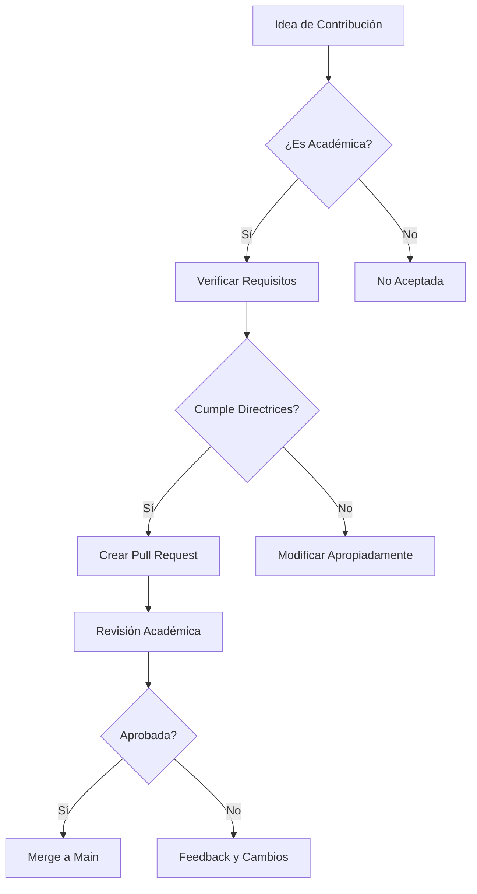

# CONTRIBUTING.md - Contribuciones Académicas

## 🎓 Propósito de las Contribuciones

Este repositorio acepta contribuciones exclusivamente con **fines académicos, educativos y de preservación histórica**. No se aceptan contribuciones que modifiquen el software para uso moderno o malicioso.

---

## 📋 Tipos de Contribuciones Permitidas

### ✅ Contribuciones Académicas

1. **Documentación Mejorada**
   - Traducciones a otros idiomas
   - Explicaciones técnicas adicionales
   - Contexto histórico ampliado

2. **Análisis de Código**
   - Comentarios académicos sobre vulnerabilidades
   - Explicación de patrones de diseño
   - Comparación con arquitecturas modernas

3. **Material Educativo**
   - Guías para cursos universitarios
   - Casos de estudio detallados
   - Ejercicios prácticos de análisis

4. **Preservación Histórica**
   - Información sobre versiones adicionales
   - Contexto de la época (2010-2011)
   - Comparativas con tecnologías contemporáneas

### ❌ Contribuciones Prohibidas

1. **Modificaciones Funcionales**
   - "Arreglos" para navegadores modernos
   - Actualizaciones de seguridad
   - Mejoras de funcionalidad

2. **Adaptaciones Maliciosas**
   - Versiones modificadas para exploits
   - Herramientas de hacking derivadas
   - Técnicas de evasión de seguridad

3. **Uso Moderno**
   - Guías para uso actual
   - Instrucciones para sistemas modernos
   - Recomendaciones de implementación

---

## 📝 Proceso de Contribución

### 1. Identificar Tipo de Contribución


### 2. Requisitos Técnicos

#### Para Documentación
```markdown
# Estructura requerida
---
type: academic_documentation
target_audience: researchers, educators
historical_period: 2010-2011
security_context: obsolete_vulnerabilities
---

## Contenido académico...
```

#### Para Análisis de Código
```vb
' Ejemplo de comentario académico
' [ACADEMIC_ANALYSIS] 
' Vulnerabilidad: Bypass de autenticación NSS
' Impacto: Acceso sin verificación de identidad
' Lección: Nunca omitir autenticación por conveniencia
If CallFunc("PK11_Authenticate", lKeySlot, True, 0) = 0 Then
```

### 3. Formato de Archivos

#### Documentación Académica
- **Markdown**: `.md` con metadatos YAML
- **PDF**: Para papers académicos formales
- **Jupyter Notebooks**: Para análisis interactivo

#### Análisis de Código
- **Comentarios estructurados**: Con etiquetas `[ACADEMIC_ANALYSIS]`
- **Documentación separada**: En archivos `.md` dedicados
- **Referencias cruzadas**: Entre código y documentación

---

## 🔍 Directrices de Contenido

### 1. Contexto Histórico
Las contribuciones deben mantener contexto claro de la época 2010-2011:

```markdown
## Contexto Histórico (2010-2011)
- **Paradigma de seguridad**: Confianza en entorno local
- **Amenazas predominantes**: Malware básico, keyloggers
- **Estado del arte**: Firefox 3.5.x - 5.0.x
- **Limitaciones tecnológicas**: Sin hardware crypto
```

### 2. Análisis de Vulnerabilidades
Explicar vulnerabilidades con enfoque educativo:

```markdown
## Análisis de Vulnerabilidad: Bypass NSS

### Descripción Técnica
El parámetro `True` en `PK11_Authenticate` omitía verificación.

### Impacto Histórico
- **2010**: Permite acceso completo sin contraseña maestra
- **2011**: Afectó a millones de usuarios
- **Lección**: La conveniencia no debe comprometer seguridad

### Evolución Posterior
- **Firefox 58+**: Autenticación obligatoria
- **Era Moderna**: Hardware-backed verification
```

### 3. Comparación con Arquitecturas Modernas
Contrastar con soluciones actuales:

```markdown
## Evolución: 2010 vs 2024

| Aspecto | Firefox 3.5 (2010) | Firefox 115 (2024) |
|---------|-------------------|-------------------|
| **Almacenamiento** | SQLite local | JSON + hardware crypto |
| **Autenticación** | Opcional | MFA obligatoria |
| **Aislamiento** | Ninguno | Sandbox completo |
| **Recuperación** | Posible | Imposible sin auth |
```

---

## 📚 Plantillas de Contribución

### Plantilla 1: Análisis de Vulnerabilidad
```markdown
# [TÍTULO] - Análisis Académico

## Resumen
Breve descripción de la vulnerabilidad analizada.

## Contexto Histórico
- **Época**: 2010-2011
- **Tecnología**: Firefox 3.5.x-5.0.x
- **Paradigma**: [Describir paradigma de seguridad]

## Análisis Técnico
### Código Vulnerable
```vb
' [Código fuente con comentarios académicos]
```

### Explicación de la Vulnerabilidad
[Detallar técnicamente el problema]

### Impacto y Consecuencias
[Explicar efectos en la época]

## Lecciones Aprendidas
[Extraer enseñanzas para arquitecturas modernas]

## Evolución Posterior
[Describir cómo se solucionó en versiones posteriores]

## Referencias
[Citar fuentes académicas o documentación]
```

### Plantilla 2: Material Educativo
```markdown
# [TÍTULO] - Guía Educativa

## Objetivo de Aprendizaje
- [ ] Comprender arquitecturas históricas
- [ ] Analizar vulnerabilidades clásicas
- [ ] Comparar con soluciones modernas

## Audiencia Objetivo
- **Nivel**: [Universitario/Profesional]
- **Prerrequisitos**: [Conocimientos requeridos]
- **Duración estimada**: [Tiempo]

## Contenido
### Módulo 1: Contexto Histórico
[Material teórico]

### Módulo 2: Análisis Práctico
[Ejercicios con código]

### Módulo 3: Comparación Moderna
[Contraste con arquitecturas actuales]

## Evaluación
[Criterios de evaluación del aprendizaje]

## Recursos Adicionales
[Material complementario]
```

---

## 🔍 Proceso de Revisión

### 1. Revisión Técnica
- **Precisión histórica**: Verificar contexto técnico
- **Exactitud del análisis**: Validar explicaciones
- **Referencias adecuadas**: Citar fuentes correctamente

### 2. Revisión Académica
- **Valor educativo**: Contribución al conocimiento
- **Claridad pedagógica**: Facilidad de comprensión
- **Rigor metodológico**: Análisis sistemático

### 3. Revisión de Seguridad
- **Sin uso malicioso**: Verificar intención académica
- **Sin exploits modernos**: Prevenir adaptaciones peligrosas
- **Contexto claro**: Marcar como material histórico

---

## 📝 Estilo y Formato

### 1. Estilo de Escritura
- **Tono académico**: Formal y objetivo
- **Claridad**: Explicaciones comprensibles
- **Precisión**: Términos técnicos correctos
- **Contextualización**: Referencias históricas claras

### 2. Formato de Código
```vb
' [ACADEMIC_ANALYSIS] Vulnerabilidad: Bypass autenticación
' [HISTORICAL_CONTEXT] Firefox 3.5.x (2010)
' [LESSON_LEARNED] Nunca omitir autenticación
If CallFunc("PK11_Authenticate", lKeySlot, True, 0) = 0 Then
```

### 3. Citas y Referencias
```markdown
Según Smith et al. (2020), "las arquitecturas de seguridad client-side
de la década de 2010 presentaban vulnerabilidades fundamentales" [1].

## Referencias
[1] Smith, J., et al. (2020). "Evolution of Web Browser Security". 
    IEEE Security & Privacy, 18(3), 45-58.
```

---

## 🚀 Proceso de Pull Request

### 1. Preparación
```bash
# Fork del repositorio
git clone https://github.com/[username]/firefox-password-recovery
cd firefox-password-recovery

# Crear rama de contribución
git checkout -b academic/[tipo]-[descripción]
```

### 2. Desarrollo
- **Seguir plantillas**: Utilizar formatos establecidos
- **Documentar cambios**: Explicar contribución académica
- **Verificar contexto**: Mantener enfoque histórico

### 3. Submit
```bash
# Commit con mensaje descriptivo
git commit -m "academic: Add analysis of NSS authentication bypass"

# Push y Pull Request
git push origin academic/[tipo]-[descripción]
# Crear PR en GitHub
```

### 4. Plantilla de PR
```markdown
## Tipo de Contribución
- [ ] Documentación académica
- [ ] Análisis de código
- [ ] Material educativo
- [ ] Preservación histórica

## Descripción
[Breve descripción de la contribución académica]

## Contexto Histórico
[Explicar relevancia para la época 2010-2011]

## Valor Educativo
[Describir cómo contribuye al aprendizaje]

## Verificación
- [ ] Sin modificaciones funcionales
- [ ] Contexto académico claro
- [ ] Referencias adecuadas
- [ ] Formato correcto
```

---

## 📞 Contacto para Contribuciones

### Para Consultas Académicas
- **GitHub Discussions**: Para colaboraciones abiertas
- **Issues**: Para preguntas sobre contribuciones específicas

### Para Propuestas de Investigación
- **Asunto**: "Academic Research Proposal"

---

## 📋 Criterios de Aceptación

### ✅ Criterios Obligatorios
1. **Propósito académico claro**
2. **Contexto histórico preciso**
3. **Sin modificaciones funcionales**
4. **Formato adecuado**
5. **Referencias correctas**

### ✅ Criterios Deseables
1. **Originalidad del análisis**
2. **Valor pedagógico demostrado**
3. **Comparación con arquitecturas modernas**
4. **Material complementario incluido**

---

## 🔄 Mantenimiento de Contribuciones

### Actualización Periódica
- **Revisión anual**: Verificar relevancia académica
- **Actualización de referencias**: Mantener citas actuales
- **Mejora continua**: Basada en feedback académico

### Retiro de Contenido
Si se determina que una contribución no cumple con los estándares académicos:

1. **Notificación al autor**: Explicar razones
2. **Período de gracia**: 30 días para corrección
3. **Retiro documentado**: Con explicación pública

---

*"Las contribuciones académicas enriquecen nuestro entendimiento colectivo de la evolución tecnológica y nos ayudan a construir un futuro más seguro."*
